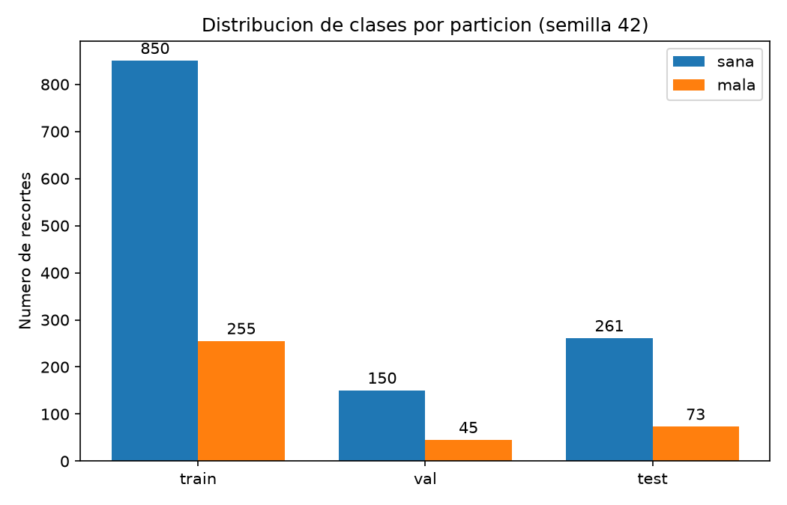
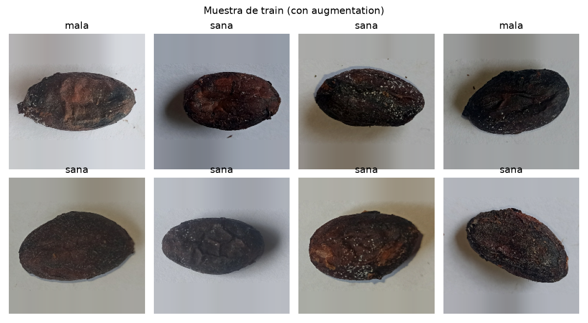
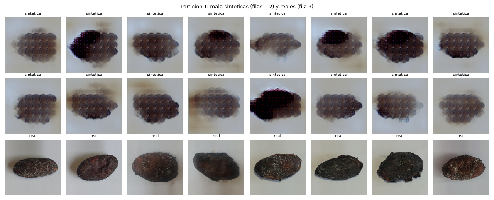

<!--
Nombre: README.md
Descripcion: Documentacion del modulo de IA de InspectIA: datos, particion, pipeline, entorno, los 5 modelos,
             Federated Learning, diagnosticos, validacion cruzada, Hyperband, experimento de GAN,
             entrenamiento federado formal, scripts, resultados, decisiones y pendientes.
Fecha_creacion: 2026-10-09
Actualizacion: 2026-10-26
Autor: Julian Andres Silvas Morales
Version: 4.1
-->

# Clasificación de granos de cacao (Proyecto final IA): InspectIA

Universidad Surcolombiana · Ingeniería de Software · Curso de Inteligencia Artificial.
Docente: Juan Antonio Castro Silva.
Equipo: Cristhian Eduardo Sánchez Mosquera, Julián Andrés Silvas Morales (módulo de IA, este README), Jhon Jairo Perdomo Perdomo.

Este repositorio contiene el **módulo de IA** de InspectIA: 5 modelos de clasificación de imágenes (3 CNN y 2 Transformers, RP-25) que clasifican cada grano de cacao como `sana` o `mala`, entrenados con **Federated Learning** (D-03, D-18) y **TensorFlow** (obligatorio). La app web (back-end, front-end, despliegue) es de otra fase.

Dataset: "Ecuadorian cacao beans for classification" (Kaggle). 1634 granos únicos: 1261 `sana` y 373 `mala`, recolectados en La Maná, Ecuador.
Licencia del dataset: CC BY-NC 4.0 (uso académico citando a los autores; no permite uso comercial, RNF-08).
Fuente: Zhinin-Vera, L. et al. (2023). Artificial Vision Technique to Detect and Classify Cocoa Beans. IWANN 2023, LNCS 14135, Springer. DOI 10.1007/978-3-031-43078-7_18.

## Contenido

1. [Estado actual y resultado principal](#estado-actual-y-resultado-principal)
2. [Estructura de carpetas](#estructura-de-carpetas)
3. [Scripts: qué hace cada uno y qué produce](#scripts-qué-hace-cada-uno-y-qué-produce)
4. [Datos: descarga, auditoría y recortes](#datos-descarga-auditoría-y-recortes)
5. [Partición](#partición-semilla-42-estratificada)
6. [Pipeline de datos](#pipeline-de-datos-data-generator)
7. [Entorno de entrenamiento](#entorno-de-entrenamiento-wsl2--tensorflow-con-gpu)
8. [Los 5 modelos](#los-5-modelos)
9. [Federated Learning](#federated-learning-fedavg-propio)
10. [Diagnósticos y cuadrícula de tasas](#diagnósticos-y-cuadrícula-de-tasas)
11. [Validación cruzada: techo de rendimiento](#validación-cruzada-techo-de-rendimiento-topic-3)
12. [Hyperparameter tuning con Hyperband](#hyperparameter-tuning-con-hyperband-topic-2)
13. [Experimento de GAN: por qué no se usa](#experimento-de-gan-para-la-clase-mala-topic-1-por-qué-no-se-usa)
14. [Entrenamiento federado formal](#entrenamiento-federado-formal-topic-6)
15. [Ensembles](#ensembles-topic-5)
16. [Medición final en test](#medición-final-en-test)
17. [Lecciones del entrenamiento](#lecciones-del-entrenamiento)
18. [Cómo reproducir](#cómo-reproducir)
19. [Decisiones acordadas](#decisiones-acordadas)
20. [Notas para el equipo](#notas-para-el-equipo-pendientes-fuera-del-módulo-de-ia)
21. [Pendientes](#pendientes)

## Estado actual y resultado principal

| Etapa | Estado | Script(s) |
|---|---|---|
| Auditoría del dataset original | ✅ | 00, 01, 02 |
| Verificación de los recortes propios | ✅ | 04 |
| Partición, conteos y gráfico | ✅ (≈ 68/12/20, **pendiente de confirmar con el profesor**) | 05, 06 |
| Data generator (`tf.data`) | ✅ | 07 |
| Entorno WSL2 + Ubuntu 24.04 + TensorFlow 2.21.0 con GPU | ✅ | — |
| Elección y verificación de las 5 arquitecturas | ✅ | 08 |
| Reparto de `train` en 5 clientes federados | ✅ | 09 |
| Ciclo de Federated Learning (FedAvg propio) | ✅ | 10 |
| Diagnósticos (preprocesamiento, sondeo lineal, errores, MobileNet) | ✅ | 11 a 15 |
| Validación cruzada de los 5 modelos (Topic 3) | ✅ | 16 |
| Hyperparameter tuning con Hyperband (Topic 2) | ✅ | 17 |
| Experimento de GAN (Topic 1) | ✅ empeora: **no se usa** | 18 |
| Entrenamiento federado formal de los 5 modelos (Topic 6) | ✅ | 10, 19 |
| Ensembles (Topic 5) | ✅ no superan al mejor modelo individual | 20 |
| Prerregistro y medición final en `test` (una sola vez) | ✅ | 21 |
| Exportar los modelos y publicarlos (GitHub Releases) | ⏳ pendiente | — |

**Resultado principal:** el **modelo de la app es EfficientNet-B0** (federado, ronda 15), elegido **antes** de mirar `test` con la regla de D-18 (el de mejor F1 en `val` entre los que clasifican un lote de 100 granos en 4 s o menos). En `test` (334 granos, usado una sola vez) logra **F1 macro 0,735 (IC 95 % 0,677–0,792) y exactitud 0,829 (0,787–0,868)**, con recall de `mala` 0,534 y de `sana` 0,912. Los 9 candidatos medidos (5 modelos y 4 ensembles) quedan entre 0,64 y 0,74 con intervalos solapados, en línea con el techo de la validación cruzada (F1 macro ≈ 0,69, IC 95 % ≈ 0,66–0,72). Ninguna palanca probada (5 arquitecturas, 384 px, sobremuestreo, GAN, Hyperband, umbral, ensembles) movió ese techo.

Sobre la meta: el documento de requerimientos no fija un número; RNF-07 remite a P-02 ("el F1-score mínimo que se defina"). La meta inicial de trabajo de 95 % de F1 macro y exactitud (propia del módulo, no del documento) resultó inalcanzable con estos datos y se reemplaza por lo medido. Propuesta para P-02, hecha antes de usar `test` a partir de la validación cruzada: **F1 macro ≥ 0,65 en `test`**, que el modelo de la app cumple.

## Estructura de carpetas

```
Proyecto_IA(Cacao-Beans)/              (en Ubuntu: ~/cacao/)
├── README.md
├── .gitignore                          excluye data/raw/*, data/processed/*, __pycache__/, .venv/, *.h5, *.pt, *.pth
├── data/
│   ├── raw/                            NO versionado (solo .gitkeep): dataset original de Kaggle
│   │   ├── .gitkeep
│   │   ├── Cacao_dataset_kaggle.zip            el .zip descargado (5,15 GB; opcional conservarlo)
│   │   ├── dataset_cropped_allclasses/         1634 .jpg (NO se usan para entrenar)
│   │   ├── dataset_original_train_val/
│   │   │   ├── train/                          1300 fotos de cámara (1000 sana, 300 mala)
│   │   │   └── val/                            334 fotos de cámara (261 sana, 73 mala)
│   │   └── labels_croppedallclasses.json       anotaciones de recorte (no se usan)
│   ├── processed/                      NO versionado (solo .gitkeep)
│   │   ├── .gitkeep
│   │   └── recortes_script/                    recortes propios del equipo (descarga en Drive, ver "Recortes propios")
│   │       ├── train/                          1300 .jpg (1000 sana, 300 mala)
│   │       ├── val/                            334 .jpg (261 sana, 73 mala)
│   │       ├── generar_recortes.py             script que generó los recortes
│   │       ├── LEEME.txt                       procedimiento y validación del separador
│   │       ├── log_train.csv, log_val.csv      regiones detectadas y tamaño de cada recorte
│   │       └── muestra_recortes.jpg            24 recortes al azar
│   └── splits/                         SÍ versionado: la partición reproducible
│       ├── train.csv                           1105 filas
│       ├── val.csv                             195 filas
│       ├── test.csv                            334 filas
│       └── federated/
│           └── client_0.csv ... client_4.csv   221 filas cada uno (reparto de train)
└── ml/
    ├── src/                            scripts numerados 00 a 19 (el 03 se eliminó); ver "Scripts"
    └── results/                        SÍ versionado: resultados livianos
        ├── inventory.csv                       00: inventario del dataset original
        ├── inventory_crops.csv                 04: inventario de los recortes propios
        ├── split_counts.csv                    06: conteos por partición y clase
        ├── split_distribution.png              06: gráfico de la partición
        ├── pipeline_sample.png                 07: muestra de un lote con augmentation
        ├── models_check.txt                    08: carga y tiempos de los 5 modelos
        ├── federated_counts.csv                09: conteos por cliente federado
        ├── errors_val.png                      14: aciertos y errores en val
        ├── diag_bn_softmax.txt                 15: diagnóstico de MobileNetV3-L
        ├── cv_ceiling/                         16: validación cruzada (<modelo>_<tamaño>[_os]_folds.csv, _resumen.txt, _resumen.json)
        ├── hyperband/                          17: Hyperband (<modelo>_trials.csv, _resumen.txt)
        ├── gan/                                18: experimento de GAN (gan_resumen.txt, gan_folds.csv, muestras_particion<k>.png)
        ├── federated_formal/                   19: entrenamiento federado formal (historiales, fl_resumen.*, modelos_elegidos.json)
        ├── ensemble/                           20: ensembles en val (ensemble_val.csv, ensemble_val_resumen.txt)
        └── test_final/                         21: preregistro.txt, tiempos_cpu_*.csv, test_resultados.csv, test_resumen.txt,
                                                    test_metricas.json y test_usado.txt (marca de que test ya se usó)
```

**Fuera del repo (no se versiona, en Ubuntu):**

| Ruta | Contenido |
|---|---|
| `~/cacao_runs/formal_<modelo>/`, `~/cacao_runs/formal3_<modelo>/` | Entrenamiento federado formal: `best.weights.h5`, `last.weights.h5` (ronda 15, la que se entrega), `state.json`, `history.csv` |
| `~/cacao_runs/cv/` | Probabilidades fuera de partición de la validación cruzada (`<config>_oof.npz`) |
| `~/cacao_runs/hyperband/<modelo>/` | Estado de keras-tuner y pesos de cada prueba |
| `~/cacao_runs/gan/` | Generadores de la GAN y probabilidades del experimento |
| `~/cacao_runs/ensemble/`, `~/cacao_runs/test_final/` | Probabilidades de cada modelo en `val` y en `test` |
| `~/cacao_runs/f1_*`, `v2_*` | Pruebas federadas de diagnóstico con EfficientNet-B0 |
| `~/cacao_runs/smoke_*`, `t1_*`, `t2_*`, `t3_*` | Corridas con el error de doble preprocesamiento: **no son evidencia** (ver "Lecciones", punto 1) |
| `~/tune/` | Logs de la cuadrícula de tasas |
| `~/*.log` | Logs de cada corrida (`cv_*.log`, `hb_*.log`, `gan_cv.log`, `formal*.log`) |
| `~/.cache/kagglehub/` | Pesos preentrenados descargados |

Cada CSV de `data/splits/` trae las columnas `origen`, `filename`, `path`, `label` y `md5`. La columna `path` es **relativa a la raíz del repo** (por ejemplo `data/processed/recortes_script/train/mala (1).jpg`), así que funciona igual en Windows y en Ubuntu si los scripts se ejecutan desde la raíz.

## Scripts: qué hace cada uno y qué produce

Todos en `ml/src/`, con header (nombre, descripción, fechas, autor, versión), semilla 42 y ejecutables desde la raíz del repo. **Solo `21_test_final.py` lee `test`, y una sola vez.**

| Script | Para qué sirve | Qué produce | Sección |
|---|---|---|---|
| `00_inventory.py` | Inventario del dataset original: ruta, etiqueta, tamaño, integridad y md5 | `ml/results/inventory.csv` | Datos |
| `01_check_pairs.py` | Comprueba si `cropped` y `train/val` son los mismos granos (por nombre) | Salida en consola | Datos |
| `02_check_names.py` | Revisa los nombres repetidos entre `train` y `val` y los de `cropped` sin foto original | Salida en consola | Datos |
| `04_inventory_crops.py` | Inventario de los recortes propios: conteos, integridad, duplicados por md5, tamaños y cruce con los logs | `ml/results/inventory_crops.csv` | Recortes |
| `05_split.py` | Partición estratificada (85/15 del train del equipo + val del equipo como test) con `assert` anti-leakage | `data/splits/train.csv`, `val.csv`, `test.csv` | Partición |
| `06_counts_plot.py` | Conteos por clase y partición y gráfico | `split_counts.csv`, `split_distribution.png` | Partición |
| `07_data_pipeline.py` | Data generator `tf.data` (relleno, redimensionado, augmentation solo en train); lo importan los demás | `pipeline_sample.png` | Pipeline |
| `08_check_models.py` | Comprueba que los 5 presets cargan con 2 clases y mide su tiempo de inferencia en GPU y CPU | `models_check.txt` | Modelos |
| `09_federated_clients.py` | Reparte `train` en 5 clientes estratificados, sin repetir granos | `data/splits/federated/client_<k>.csv`, `federated_counts.csv` | Federated Learning |
| `10_train_federated.py` | **Entrenamiento con Federated Learning** (FedAvg propio, v1.7): checkpoints por ronda y reanudación | `~/cacao_runs/<tag>_<modelo>/` (pesos, `history.csv`, `state.json`) | FL, entrenamiento formal |
| `11_central_check.py` | Diagnóstico: entrenamiento centralizado con F1 de train y val por época; se usó para la cuadrícula de tasas | Salida en consola (logs en `~/tune/`) | Diagnósticos |
| `12_feature_probe.py` | Diagnóstico: regresión logística sobre características congeladas de EfficientNet con 3 preprocesamientos | Salida en consola | Diagnósticos |
| `13_probe_cv.py` | Diagnóstico: validación cruzada del sondeo lineal frente a usar solo la proporción ancho/alto | Salida en consola | Diagnósticos |
| `14_errors_view.py` | Diagnóstico: cuadrícula de aciertos y errores en val para revisarlos a ojo | `errors_val.png` | Diagnósticos |
| `15_diag_bn_softmax.py` | Diagnóstico del montaje de los 5 modelos (BatchNorm congeladas, softmax); encontró el fallo de MobileNet | `diag_bn_softmax.txt` (resumen) | Lecciones (9) |
| `16_cv_ceiling.py` | **Validación cruzada** de 5 particiones con intervalos por bootstrap; opciones `--img-size` y `--oversample` | `ml/results/cv_ceiling/`, `~/cacao_runs/cv/` | Validación cruzada |
| `17_hyperband.py` | **Hyperband** (keras-tuner) por modelo sobre tasa, weight decay y épocas | `ml/results/hyperband/` | Hyperband |
| `18_gan_cv.py` | **Experimento de GAN** (DCGAN + DiffAugment por partición) comparado con la validación cruzada | `ml/results/gan/` | GAN |
| `19_fl_summary.py` | Resume el entrenamiento federado formal y elige la variante de cada modelo | `ml/results/federated_formal/` | Entrenamiento formal |
| `20_ensemble.py` | **Ensembles** heterogéneo, homogéneo e híbrido con los modelos federados, solo en `val` | `ml/results/ensemble/` | Ensembles |
| `21_test_final.py` | **Medición final en `test`, de un solo uso** (se bloquea tras usarse); `--solo-tiempos --hilos N` mide el tiempo por grano en CPU sin leer `test` | `ml/results/test_final/` | Medición final |

El script que generó los recortes (`generar_recortes.py`) no está en `ml/src/`: viene dentro de `recortes_script/` (ver "Recortes propios").

## Datos: descarga, auditoría y recortes

### Descarga del dataset original

El dataset **no se versiona** por su tamaño (el .zip pesa 5,15 GB); el profesor confirmó que basta el enlace.

1. Entrar a: https://www.kaggle.com/datasets/luiszhinin979/ecuadorian-cocoa-beans-for-classification
2. Descargar el `.zip` (requiere cuenta de Kaggle).
3. Extraerlo dentro de `data/raw/` (ver "Estructura de carpetas").

### Auditoría del dataset original (`00`, `01`, `02`)

**Por qué:** antes de entrenar había que saber qué contiene el dataset, si hay duplicados o archivos dañados, y qué carpeta usar.

- `dataset_cropped_allclasses/`: 1634 imágenes (una por grano), etiqueta en el nombre. 0 corruptas y 0 duplicados exactos (`00_inventory.py`).
- `dataset_original_train_val/`: 1634 fotos de cámara (4624x3472 y 4624x2136), un grano por foto, ya divididas en train (1300) y val (334).
- `labels_croppedallclasses.json`: anotaciones de recorte (formato VGG Image Annotator); no se usa para clasificar.
- Las carpetas `train/val` y `cropped` no comparten contenido idéntico (`01_check_pairs.py`). Hipótesis (no confirmada al 100 %): son las fotos originales y sus recortes de los mismos granos.
- En `val`, los nombres de las 73 `mala` se repiten con los de `train` con contenido distinto (`02_check_names.py`): **el nombre no sirve como clave; se usa siempre la ruta completa.**
- La descripción de Kaggle habla de 3268 imágenes ("entero y corte transversal"). **Verificado:** el .zip trae 3268 imágenes = 1634 (`cropped`) + 1634 (originales), más el JSON. **No hay imágenes de corte transversal aparte**: todas muestran el exterior del grano.

### Recortes propios (datos de entrenamiento)

**Qué son:** un recorte por grano, generado por el equipo (Cristhian) a partir de las fotos originales de `dataset_original_train_val/` con `generar_recortes.py` (OpenCV, sin filtros sobre la imagen), **con el mismo procedimiento que usará la app** para separar los granos de la foto de un lote (D-08, RF-07).

**Descarga:** la carpeta `recortes_script/` (recortes, script, logs y LEEME) está en Google Drive:
**https://drive.google.com/file/d/1OJ9_dF3s0AWgnF95FMsaB1Q6oOLOKZV4/view**
Descargarla y descomprimirla en `data/processed/recortes_script/`. No se versiona en Git por su tamaño.

**Por qué no se usa `dataset_cropped_allclasses`:** trae un filtro que la app no aplica (fondo oscurecido) y no se sabe a qué foto original corresponde cada recorte. Entrenar con él haría que el modelo viera imágenes distintas a las que recibirá en la app.

**Cómo se generan** (según `generar_recortes.py` y su LEEME): cada foto se lee a la mitad de su resolución; se estima la iluminación del papel y se divide la imagen por ella; se marca como grano lo más oscuro que 0,6 veces el papel; se toma la región más grande, se gira para dejar el eje largo horizontal y se recorta con un margen del 15 % del lado corto. Según el LEEME, el separador encontró el grano anotado en el 99,8 % de las fotos (4 casos con una arruga o mancha adicional, revisados a mano).

**Verificación (`04_inventory_crops.py`, en Windows y en Ubuntu con el mismo resultado):**

- `train/`: 1300 recortes (1000 sana, 300 mala) y `val/`: 334 recortes (261 sana, 73 mala), igual que el LEEME.
- 0 archivos corruptos, 0 duplicados por md5, 0 contenido compartido entre train y val, y los logs coinciden con lo que hay en disco.
- Tamaño: mediana 596x370 px, mínimo 340x201, máximo 1459x896.
- La clase sale del nombre del archivo (`sana (N).jpg`, `mala (N).jpg`).

## Partición (semilla 42, estratificada)

Los recortes ya vienen separados por el equipo en `train` (1300) y `val` (334). `05_split.py` produce:

| Conjunto | Origen | Uso | Recortes | sana | mala | % mala | % del total |
|---|---|---|---|---|---|---|---|
| train | 85 % de `train` del equipo | entrenar (y repartir entre clientes de Federated Learning) | 1105 | 850 | 255 | 23,1 | 67,6 |
| val | 15 % de `train` del equipo | elegir modelo, hiperparámetros y ronda | 195 | 150 | 45 | 23,1 | 11,9 |
| test | `val` del equipo, sin tocar | medición final, usada una sola vez | 334 | 261 | 73 | 21,9 | 20,4 |

Conteos y gráfico de `06_counts_plot.py` (`ml/results/split_counts.csv`):



Ojo con los nombres: **lo que el documento de requerimientos llama "validación" (334) aquí es `test`.**

### Por qué se particionó así

El profesor pidió una partición 70/15/15. El resultado es ≈ 68/12/20, es decir, **no es exacta**. Se eligió porque cumple el propósito de la pauta y es coherente con el documento del equipo:

- **Sin data leakage.** Los tres conjuntos son disjuntos: el script verifica con `assert` que no hay solapamiento por ruta ni por md5 y que suman 1634.
- **La selección y la medición final están separadas.** Los modelos se comparan y ajustan con `val`; el F1 que se reporta sale de `test`, que no interviene en ninguna decisión. Si un mismo conjunto eligiera el modelo y además midiera el F1, la cifra saldría optimista.
- **Coherencia con el documento de requerimientos y el LEEME:** RNF-07 fija la medición en `recortes_script/val` (334 granos), y el LEEME dice que ese conjunto es "solo para la medición final" y que la validación se saque de train (por ejemplo, el 15 %). El 70/15/15 no aparece en el documento del equipo.
- **Un test de 334 tiene menos ruido que uno de 246** (el que saldría con 15 % de 1634), y conserva la partición de los autores del dataset.
- `train` y `val` están estratificados (23,1 % de `mala`); `test` tiene 21,9 %, una diferencia pequeña.

Limitación: con 73 granos `mala` en `test` y 45 en `val`, un error mueve el recall de esa clase más de un punto; por eso el techo se midió además con validación cruzada.

**Pendiente:** confirmar esta justificación con el profesor. Si exige 70/15/15 exacto, solo cambia `05_split.py` (juntar los 1634 y repartir) y habría que ajustar D-18 y RNF-07.

## Pipeline de datos (data generator)

`07_data_pipeline.py` lee `data/splits/*.csv` y entrega los recortes por lotes con `tf.data`, sin cargar todo en memoria (requisito del Topic 1). Lo importan todos los scripts de entrenamiento.

| Decisión | Valor | Por qué |
|---|---|---|
| Tamaño de entrada | 224x224 (`IMG_SIZE`, configurable) | Los 5 presets son de 224; **384 se probó en la validación cruzada y no mejora** |
| Redimensionado | Cuadrado sin deformar el grano, prolongando y suavizando el borde de cada recorte | Estirar deformaría el grano; ver nota |
| Normalización | Ninguna en el pipeline (píxeles 0 a 255) | Cada modelo aplica la de su preset (ver "Lecciones", puntos 1 y 2) |
| Augmentation | Solo en `train`: volteos horizontal y vertical, brillo y contraste leves | `val` y `test` no se modifican; sin cambios de color porque el color distingue `sana` de `mala` (hipótesis, no verificada) |
| Etiquetas | sana = 0, mala = 1 | |
| Lote | 32 | 35 lotes en train, 7 en val, 11 en test |

**Nota sobre el relleno.** Con relleno blanco se veía un borde marcado contra el papel: el borde de 200 recortes de `train` mide (165, 165, 167) de media, un gris medio. Además, la proporción ancho/alto difiere un poco entre clases (1,55 en `mala` y 1,62 en `sana`) y un clasificador que usa solo esa proporción logra F1 macro 0,543 en validación cruzada (`13_probe_cv.py`); como el relleno depende de la proporción, podría actuar como atajo. Por eso se prolonga el borde de cada recorte, suavizado a 16 valores. No se midió contra el relleno blanco: la comparación se descartó antes de usar `test` (ver "Prerregistro").

**El pipeline no es el cuello de botella:** recorrer las 1105 imágenes de `train` tarda ≈ 1,2 s por época, frente a 4 a 9 s de una época de entrenamiento.



## Entorno de entrenamiento: WSL2 + TensorFlow con GPU

TensorFlow es obligatorio (decisión del profesor). La documentación oficial indica que **desde la versión 2.11 TensorFlow no tiene soporte de GPU en Windows nativo**; por eso el entrenamiento se hace en Ubuntu dentro de WSL2, y el entorno `.venv` de Windows solo se usó para los scripts de datos 00 a 06.

Equipo de desarrollo: Windows 10 22H2, GPU NVIDIA RTX 3060 Ti (8 GB), driver 596.49. Ubuntu en WSL2 ve unos 15 GiB de RAM.

### Versiones verificadas

| Componente | Versión |
|---|---|
| Sistema | WSL2, Ubuntu 24.04.5 LTS |
| Python | 3.12.3 (viene con Ubuntu 24.04) |
| TensorFlow / Keras | 2.21.0 (`tensorflow[and-cuda]`) / 3.15.1 |
| keras-hub | 0.32.0 (modelos preentrenados) |
| keras-tuner | 1.4.8 (Hyperband; comprobado con `--dry-run` que no cambia TensorFlow, Keras ni numpy) |
| numpy / pandas / pillow / scikit-learn / matplotlib | 2.5.4 / 3.0.6 / 13.0.0 / 1.9.1 / 3.11.2 |
| Entorno virtual | `~/entornos/tf` |

Python 3.12 figura en las versiones soportadas por TensorFlow según la documentación oficial (que es inconsistente: una tabla lista 3.10 a 3.13 y otra sección 3.9 a 3.12). Python 3.14 no aparece y por eso no se usa para entrenar.

### Paso a paso

**1. Comprobar WSL2 (en CMD de Windows).** Se necesita Windows 10 21H2 o superior y un driver NVIDIA reciente.

```cmd
wsl --status
wsl -l -v
nvidia-smi
```

**2. Instalar Ubuntu 24.04** (en CMD). Pide crear un usuario y una contraseña de Linux.

```cmd
wsl --install Ubuntu-24.04
```

**3. Comprobar que Ubuntu ve la GPU y la versión de Python** (en Ubuntu):

```bash
python3 --version
nvidia-smi
```

**4. Crear el entorno virtual e instalar TensorFlow con GPU:**

```bash
sudo apt update
sudo apt install -y python3-venv python3-pip
cd ~
mkdir -p entornos
python3 -m venv entornos/tf
source entornos/tf/bin/activate
pip install --upgrade pip
pip install 'tensorflow[and-cuda]'
```

**5. Indicar dónde están las bibliotecas NVIDIA.** Tras instalar, `tf.config.list_physical_devices('GPU')` devolvía `[]` con el aviso "Cannot dlopen some GPU libraries": las bibliotecas existían y cargaban por ruta completa, pero **no por nombre**. Los enlaces simbólicos que sugiere la documentación no lo resolvieron; lo que funcionó fue añadir esas rutas a `LD_LIBRARY_PATH` cada vez que se activa el entorno:

```bash
cat >> ~/entornos/tf/bin/activate <<'EOF'

# Rutas de las bibliotecas NVIDIA instaladas por pip (para que TensorFlow vea la GPU)
_NV_LIBS=$(python -c "import site,glob; print(':'.join(sorted(glob.glob(site.getsitepackages()[0] + '/nvidia/*/lib'))))")
export LD_LIBRARY_PATH="$_NV_LIBS${LD_LIBRARY_PATH:+:$LD_LIBRARY_PATH}"
EOF
```

Por eso **siempre hay que activar el entorno** (`source ~/entornos/tf/bin/activate`), también en shells no interactivas: sin ese paso TensorFlow no ve la GPU.

**6. Instalar las librerías de datos, modelos y tuning** (en el mismo entorno):

```bash
pip install pandas pillow scikit-learn matplotlib keras-hub keras-tuner
```

No instalar ni actualizar paquetes sin comprobar antes con `pip install --dry-run`: un cambio de `numpy`/`keras`/`tensorflow` puede romper la GPU.

**7. Verificar** (en una terminal nueva, con el entorno activado):

```bash
source ~/entornos/tf/bin/activate
python -c "import tensorflow as tf; print(tf.__version__, tf.config.list_physical_devices('GPU'))" 2>/dev/null
```

Salida esperada: `2.21.0 [PhysicalDevice(name='/physical_device:GPU:0', device_type='GPU')]`.

### Clonar el repo en Ubuntu y copiar los recortes

El repo se trabaja en el disco de Ubuntu (`~/cacao`), no en `/mnt/c`: leer miles de imágenes por `/mnt/c` es mucho más lento.

```bash
cd ~
git clone https://github.com/JulianSilvaMorales/Proyecto_IA-Cacao-Beans-.git cacao
cp -r "/mnt/c/Users/USER/Documents/Proyecto_IA(Cacao-Beans)/data/processed/recortes_script" ~/cacao/data/processed/
cd ~/cacao
git config --global user.name "su-usuario-de-github"
git config --global user.email "su-correo-de-github"
```

(Ajustar la ruta de Windows a cada equipo.) Al hacer `git push` desde Ubuntu, GitHub pide un **token de acceso personal** en lugar de la contraseña: no se escribe en chats, archivos ni comandos guardados.

### Entrenamientos largos en WSL2: dos ventanas de CMD

- **Al cerrar la última ventana de Ubuntu, WSL2 apaga la distribución y mata los procesos** (probado: un proceso murió a los ~78 s).
- Forma de trabajo:
  - **CMD A (keep-alive):** `wsl -d Ubuntu-24.04 -- sleep infinity`. Se deja abierta mientras se trabaja.
  - **CMD B (principal):** donde se ejecutan los comandos del proyecto.
- Las corridas largas (validación cruzada, Hyperband, entrenamiento formal) se lanzaron con `nohup ... > ~/algo.log 2>&1 &` y se siguen con `tail -f ~/algo.log`; `python -u` evita que el log salga con búfer. También se puede entrenar en primer plano con `python -u ... 2>&1 | tee archivo.log`.
- `10_train_federated.py` y `17_hyperband.py` guardan su estado y **reanudan** con el mismo comando si se cortan (ojo: una corrida nueva con el mismo `--tag` reanuda la anterior).
- Antes de un entrenamiento largo, configurar Windows para no suspenderse mientras está enchufado.

## Los 5 modelos

Todos preentrenados en ImageNet (**transfer learning**: con ~1100 imágenes de entrenamiento no tiene sentido entrenarlos desde cero; no confirmado con el profesor) y de 224x224, así que comparten el mismo pipeline. `08_check_models.py` (resultado en `ml/results/models_check.txt`) confirmó que los 5 cargan con 2 clases de salida.

| # | Modelo | Preset de KerasHub | Parámetros | Tipo |
|---|---|---|---|---|
| 1 | MobileNetV3-L | `mobilenet_v3_large_100_imagenet` | 4,2 M | CNN |
| 2 | EfficientNet-B0 | `efficientnet_b0_ra4_e3600_r224_imagenet` | 4,1 M | CNN |
| 3 | ResNet-50 | `resnet_50_imagenet` | 23,6 M | CNN |
| 4 | Swin-Tiny | `swin_tiny_patch4_window7_224` | 27,5 M | Transformer |
| 5 | DeiT-Small | `deit_small_distilled_patch16_224_imagenet` | 21,7 M | Transformer |

**Por qué estos:** diseños distintos entre sí (útil para los ensembles del Topic 5) y tamaño compatible con inferencia en CPU (D-18: la app corre sin GPU en una t4g.medium).

**Tiempos de inferencia medidos con `08_check_models.py`** (lote de 32, en este equipo; la CPU no es la de AWS, así que sirven para comparar modelos entre sí, no como cifra final de RNF-01):

| Modelo | GPU ms/img | CPU ms/img |
|---|---|---|
| MobileNetV3-L | 41,6 (anómalo, causa desconocida) | 30,4 |
| EfficientNet-B0 | 4,8 | 21,1 |
| ResNet-50 | 2,7 | 30,6 |
| Swin-Tiny | 7,3 | 55,3 |
| DeiT-Small | 3,7 | 48,9 |

**Cómo se montan (igual para los 5):** el modelo se carga con `preprocessor=None` y `activation=None` (entrega logits), la pérdida usa `from_logits=True` con peso por clase, y el `image_converter` del preset se aplica una sola vez en el pipeline. Todas las `BatchNormalization` se congelan (usan las estadísticas de ImageNet). Las razones están en "Lecciones" (puntos 1, 2, 4 y 9).

## Federated Learning (FedAvg propio)

**Por qué Federated Learning:** lo pide el profesor (Topic 6) y el documento del equipo (D-03, D-18). Se eligió Federated y no Distributed Learning porque una sola persona entrena los modelos; al profesor solo le interesa que se use Federated Learning, no una librería concreta.

- **5 clientes simulados** con reparto estratificado de `train` (`09_federated_clients.py`): cada uno recibe 221 granos (170 `sana` y 51 `mala`), sin repetir ninguno (verificado; conteos en `ml/results/federated_counts.csv`). Con 10 clientes cada uno tendría ~25 `mala`, demasiado pocos.
- **FedAvg propio** en Keras (`10_train_federated.py`): en cada ronda cada cliente parte de los pesos globales, entrena localmente y el servidor promedia los pesos ponderando por tamaño. No se comprobó si TensorFlow Federated funciona con TensorFlow 2.21 y Python 3.12.
- `val` y `test` son globales: los clientes no los ven. Cada ronda se mide el F1 macro, la exactitud y el recall de `mala` en `val`, y se guardan `best.weights.h5`, `last.weights.h5`, `state.json` y `history.csv`. El script **no usa `test`**.
- Pérdida con peso por clase ([sana, mala] ≈ [0,65, 2,17]) por el desbalance.
- El modelo se **compila una sola vez** y en cada cliente se reinicia el estado del optimizador sin tocar la tasa de aprendizaje (antes se recompilaba por cliente y cada ronda tardaba ≈ 90 s; ahora ≈ 13–22 s con EfficientNet-B0).
- Opciones (v1.7): `--model --rounds --local-epochs --lr --weight-decay --clipnorm --freeze-bn --jit --tag`.
- El reparto estratificado es el caso fácil (todos los clientes tienen datos parecidos).

## Diagnósticos y cuadrícula de tasas

Antes del entrenamiento formal hubo que encontrar una configuración estable y entender por qué el F1 no subía de ~0,70. Todo se midió en `val` (195 recortes, 45 `mala`), sin usar `test`. **No son el entrenamiento formal.**

**Pruebas con EfficientNet-B0:**

| Prueba | Script | F1 macro | Comentario |
|---|---|---|---|
| Azar / siempre `sana` | — | ~0,43 | exactitud 0,77 |
| Solo proporción ancho/alto (CV 5 particiones sobre train+val) | 13 | 0,543 ± 0,020 | |
| Regresión logística sobre características congeladas (CV) | 13 | 0,669 ± 0,024 | las características aportan señal sobre la proporción |
| Preprocesamiento: converter del preset / media-desv. ImageNet / solo /255 | 12 | 0,668 / 0,478 / 0,631 | el correcto es el del preset |
| Entrenamiento centralizado estable (20 épocas) | 11 | 0,60 a 0,73 | `train` ~0,95: sobreajuste |
| Federated Learning, 10 rondas x 2 épocas locales, lr 3e-5 | 10 | 0,677 (ronda 10) | exactitud 0,774, recall `mala` 0,49 |
| Ajuste fino en dos fases (cabeza sola y luego red completa) | 11 | máx 0,727, final 0,642 | `train` sube a 0,85, `val` no |

**Cuadrícula de tasas de aprendizaje** (`11_central_check.py`, centralizado, 20 épocas, BatchNorm congeladas, clipnorm 1,0). Promedio del F1 macro en `val` de las últimas 5 épocas:

| Modelo | lr 1e-5 | lr 3e-5 | lr 1e-4 |
|---|---|---|---|
| EfficientNet-B0 | **0,695** | 0,687 | 0,349 (diverge) |
| ResNet-50 | 0,677 | **0,729** | 0,693 |
| Swin-Tiny | **0,719** | 0,726 | 0,693 |
| DeiT-Small | **0,697** | 0,679 | 0,679 |
| MobileNetV3-L (corregido el 23-oct) | **0,726** | 0,704 | 0,671 |

La fila de MobileNetV3-L se repitió con `11_central_check.py` v1.5 tras corregir sus dos fallos de montaje (ver "Lecciones", punto 9); la fila antigua (0,46–0,48) no es válida. Logs en `~/tune/`.

Lectura: los 5 modelos quedan en el mismo nivel (≈ 0,68 a 0,73) y con 45 `mala` en `val` no se puede decir cuál es mejor; hay sobreajuste fuerte (`train` 0,95 a 1,00). En la cuadrícula de errores (`14_errors_view.py`, `ml/results/errors_val.png`) varias `mala` mal clasificadas se parecen a `sana` a simple vista y algunas `sana` tienen manchas blancas parecidas a las de `mala`. Estas observaciones llevaron a medir el techo con validación cruzada.

## Validación cruzada: techo de rendimiento (Topic 3)

**Por qué:** `val` tiene solo 45 `mala`, así que sus cifras tienen un ruido de ±0,05. Para medir el techo con rigor, `16_cv_ceiling.py` hace una **validación cruzada estratificada de 5 particiones sobre `train` + `val` (1300 recortes, 300 `mala`)**, con entrenamiento centralizado y la misma configuración de la cuadrícula (BatchNorm congeladas, clipnorm 1,0, logits, pesos de clase, tasa de la cuadrícula, 15 épocas). Las particiones se generan en memoria (semilla 42): **no cambia `data/splits/` ni usa `test`**. Cada grano recibe una predicción "fuera de partición" y el intervalo de confianza del 95 % sale por bootstrap (2000 remuestras). Resúmenes en `ml/results/cv_ceiling/`.

| Configuración | F1 macro, época 15 (IC 95 %) | F1 macro, mejor época* | Exactitud | Recall `mala` | Recall `sana` |
|---|---|---|---|---|---|
| EfficientNet-B0, 224, lr 1e-5 | 0,692 (0,664–0,721) | 0,698 (época 10) | 0,778 | 0,54 | 0,85 |
| MobileNetV3-L, 224, lr 1e-5 | 0,692 (0,663–0,721) | 0,703 (época 11) | 0,763 | 0,61 | 0,81 |
| ResNet-50, 224, lr 3e-5 | 0,692 (0,661–0,718) | 0,689 (época 13) | 0,765 | 0,60 | 0,82 |
| Swin-Tiny, 224, lr 1e-5 | 0,689 (0,659–0,718) | 0,698 (época 3) | 0,785 | 0,50 | 0,87 |
| DeiT-Small, 224, lr 1e-5 | 0,652 (0,620–0,682) | 0,693 (época 11) | 0,779 | 0,38 | 0,90 |
| EfficientNet-B0, **384** | 0,674 (0,647–0,702) | 0,697 (época 8) | 0,751 | 0,58 | 0,80 |
| MobileNetV3-L, **384** | 0,695 (0,665–0,723) | 0,695 (época 15) | 0,765 | 0,62 | 0,81 |
| EfficientNet-B0, 224, **sobremuestreo de `mala` ×3** (sin pesos de clase) | 0,651 (0,622–0,680) | 0,674 (época 6) | 0,734 | 0,53 | 0,79 |

\*Época con mejor F1 medio de las 5 particiones: algo optimista, porque se elige con los mismos datos. Exactitud y recalls de la tabla: época 15.

Referencias: predecir siempre `sana` da F1 ≈ 0,43 (exactitud 0,77); usar solo la proporción ancho/alto, 0,54.

Lectura (medido):

- **El techo con estos datos es F1 macro ≈ 0,69, con intervalo ≈ 0,66 a 0,72**, exactitud ≈ 0,76 a 0,79 y recall de `mala` ≈ 0,5 a 0,6. Los 5 modelos, CNN y Transformers, quedan en el mismo nivel: **ninguno se separa del resto**. El 0,72–0,73 que se veía en `val` para ResNet y Swin era ruido.
- **384 px no mejora** frente a 224. **Sobremuestrear `mala` empeora** frente a los pesos de clase y es más inestable. Ajustar el umbral apenas sube el F1 (≈ +0,01, y de forma optimista).
- **El número de épocas importa y depende del modelo:** Swin alcanza su mejor nivel en la época 3 y DeiT pierde recall de `mala` al seguir entrenando. Por eso las épocas se fijaron con Hyperband.
- El modelo es inestable entre épocas: en una misma partición el recall de `mala` puede saltar de 0,4 a 0,9. Hay muchos granos en la frontera entre clases.
- **La meta inicial de trabajo de 95 % no es alcanzable con estos recortes**: el intervalo medido está más de 20 puntos por debajo. Explicación más probable, **sin comprobar**: el exterior del grano no basta para reproducir una etiqueta asignada también por fermentación (coherente con D-17).

## Hyperparameter tuning con Hyperband (Topic 2)

**Por qué:** el profesor pidió ajuste de hiperparámetros con Hyperband, y la validación cruzada mostró que el número de épocas depende del modelo.

`17_hyperband.py` (keras-tuner 1.4.8) busca por modelo la **tasa de aprendizaje** (continua, de 5e-6 a 1e-4 en escala logarítmica), el **weight decay** de AdamW (0, 1e-4 o 1e-2) y el **número de épocas** (Hyperband las reparte; máximo 20, factor 3, 30 pruebas por modelo). Entrenamiento centralizado sobre `train`, objetivo F1 macro en `val`; **no usa `test`**. Fija lo ya decidido con evidencia: BatchNorm congeladas, clipnorm 1,0, logits, 224 px y pesos de clase. Resúmenes en `ml/results/hyperband/`.

| Modelo | Mejor F1 en `val` | lr | Weight decay | Mejor época | F1 en la validación cruzada (referencia) |
|---|---|---|---|---|---|
| MobileNetV3-L | 0,776 | 9e-5 | 0 | 3 | 0,692 |
| Swin-Tiny | 0,772 | 6e-6 | 0 | 12 | 0,689 |
| DeiT-Small | 0,768 | 9e-5 | 0 | 4 | 0,652 |
| ResNet-50 | 0,753 | 9e-5 | 0 | 9 | 0,692 |
| EfficientNet-B0 | 0,736 | 4,6e-5 | 1e-2 | 4 | 0,692 |

Lectura:

- **No hay un ganador claro.** Las 5 mejores pruebas de cada modelo quedan a menos de 0,03 entre sí y los 5 modelos a menos de 0,04: con 45 `mala` es ruido.
- **Las cifras de Hyperband son optimistas:** cada una es el máximo de 30 intentos sobre el mismo `val`, por eso superan a la validación cruzada (≈ 0,69), que sigue siendo la estimación honesta del techo.
- **Lo que aporta (medido):** el weight decay no ayuda (gana 0 en 4 de 5 modelos) y **las mejores épocas son pocas, de 3 a 12**.
- **Sus tasas no se trasladan tal cual a Federated Learning** (medido en el entrenamiento formal): ver la sección siguiente.
- Swin-Tiny se ajustó con XLA (`--jit`) y una prueba por proceso; los otros 4 sin XLA y 5 pruebas por proceso (ver "Lecciones", punto 10).

## Experimento de GAN para la clase `mala` (Topic 1): por qué no se usa

**Por qué se probó:** el profesor incluyó las GANs en la preparación del dataset, y `mala` es la clase minoritaria (23 %). Antes del entrenamiento formal se midió si generar `mala` sintéticas mejora al clasificador (`18_gan_cv.py`).

- **Diseño, sin leakage:** las mismas 5 particiones de la validación cruzada de EfficientNet-B0 (comprobado por ruta). En cada partición se entrena una **DCGAN de 128×128 con spectral normalization y DiffAugment** (técnica para GANs con pocos cientos de imágenes) **solo con las ~240 `mala` del train de esa partición**, se generan ~560 `mala` sintéticas hasta igualar a las `sana` y se entrena EfficientNet-B0 con reales + sintéticas, con la misma configuración que la validación cruzada. Comparación **pareada** con la línea base sin GAN, sobre los mismos 1300 granos, con bootstrap de la diferencia. No usa `test`.

| Métrica | Con GAN | Sin GAN | Diferencia (IC 95 %) |
|---|---|---|---|
| F1 macro | 0,629 | 0,692 | **−0,063 (−0,099 a −0,029)** |
| Exactitud | 0,761 | 0,778 | −0,018 (−0,042 a +0,006) |
| Recall `mala` | 0,357 | 0,540 | **−0,183 (−0,246 a −0,122)** |
| Recall `sana` | 0,882 | 0,850 | +0,032 (+0,008 a +0,056) |



Por qué no se usa la GAN:

1. **Empeora el modelo de forma significativa (medido):** el intervalo de la diferencia de F1 macro queda entero por debajo de 0, y el recall de `mala` cae 18 puntos.
2. **Las imágenes sintéticas no son realistas (visto en las muestras de las 5 particiones):** la GAN colapsa a casi una sola forma (*mode collapse*) con artefactos de tablero y no reproduce la textura del grano. Con ~240 imágenes no alcanza para aprender la variedad de los granos `mala`.
3. **Explicación del empeoramiento (hipótesis coherente con los números):** el clasificador aprende a reconocer los artefactos de las sintéticas como "mala"; las `mala` reales no los tienen, así que muchas pasan como `sana`.
4. Es coherente con el sobremuestreo de `mala` ×3, que también empeoró (F1 0,651): añadir `mala` artificiales no aporta información nueva.

Limitaciones: una sola arquitectura de GAN (DCGAN + DiffAugment, 6000 pasos, 128 px ampliados a 224). **No se probó** una GAN más potente (por ejemplo StyleGAN2-ADA); su coste es mucho mayor y la evidencia no apunta a que vaya a subir el techo.

## Entrenamiento federado formal (Topic 6)

**Qué es:** el entrenamiento que produce los 5 modelos que se comparan (D-18) y entre los que se elige el de la app. Configuración común: `10_train_federated.py` v1.7, **5 clientes, FedAvg, 15 rondas x 1 época local**, todas las BatchNorm congeladas, clipnorm 1,0, pesos de clase, 224 px, sin GAN. Swin-Tiny con XLA (`--jit`), porque sin XLA no cabe en 8 GB. Historiales y resumen en `ml/results/federated_formal/` (`19_fl_summary.py`).

**Cómo se eligió la tasa (dos variantes por modelo):**

1. **Variante 1, tasa de Hyperband** (tag `formal`). Con 10 rondas, EfficientNet-B0 se desestabilizó (alternaba entre "todo mala" y "todo sana") y Swin-Tiny no llegaba a converger con su tasa tan baja.
2. **Variante 2, tasa alternativa** (tag `formal3`): un tercio de la tasa de Hyperband, y el triple para Swin-Tiny (su problema era el contrario).
3. Ambas a 15 rondas. **Criterio, declarado antes de ver los resultados:** el promedio del F1 macro en `val` de las rondas 11 a 15 (no la mejor ronda, que es el pico del ruido).

| Modelo | Variante 1 (tasa de Hyperband) | Variante 2 (tasa alternativa) | Elegida | Recall `mala` (rondas 11–15) | F1 ronda 15 |
|---|---|---|---|---|---|
| Swin-Tiny | 0,661 (lr 6,2e-6) | **0,720** (lr 1,9e-5) | variante 2 | 0,67 | 0,748 |
| MobileNetV3-L | **0,697** (lr 9,0e-5) | 0,678 (lr 3,0e-5) | variante 1* | 0,49 | 0,664 |
| DeiT-Small | 0,650 (lr 9,0e-5) | **0,680** (lr 3,0e-5) | variante 2 | 0,53 | 0,720 |
| EfficientNet-B0 | 0,393 (inestable; lr 4,6e-5, wd 1e-2) | **0,669** (lr 1,5e-5, wd 1e-2) | variante 2 | 0,59 | 0,682 |
| ResNet-50 | 0,651 (lr 9,0e-5) | **0,664** (lr 3,0e-5) | variante 2* | 0,58 | 0,668 |

Promedio del F1 macro en `val` de las rondas 11 a 15. \*Diferencia menor que 0,03: empate dentro del ruido; se aplica el criterio declarado (gana el promedio más alto).

Lectura (medido):

- **Ajustar la tasa dentro de Federated Learning arregló la inestabilidad:** EfficientNet-B0 pasa de 0,39 a 0,669, con las 5 últimas rondas entre 0,664 y 0,682.
- **Los 5 modelos federados quedan en 0,66–0,72**, en línea con el techo de la validación cruzada (≈ 0,69). Swin-Tiny queda algo por encima, pero con 45 `mala` la diferencia no es concluyente; la comparación definitiva sale de `test`.
- **Por qué las tasas de Hyperband no servían tal cual (hipótesis coherente con los datos):** en este FedAvg cada cliente reinicia Adam en cada ronda y solo da 7 pasos; los primeros pasos de Adam son relativamente grandes, así que una tasa estable en centralizado (Adam "caliente" durante muchas épocas) resulta demasiado agresiva aquí.
- **Se entrega la ronda 15** (`last.weights.h5`) de la variante elegida, no la de mejor F1 en `val`, por la misma razón: la mejor ronda es el pico del ruido y las rondas finales ya son estables. La lista exacta está en `ml/results/federated_formal/modelos_elegidos.json`.

## Ensembles (Topic 5)

**Por qué:** el profesor incluyó los ensembles (heterogéneo, homogéneo e híbrido). `20_ensemble.py` los arma con los modelos del entrenamiento federado formal (ronda 15), **sin entrenar nada nuevo**, y los evalúa **solo en `val`**:

- **Heterogéneo:** los 5 modelos elegidos (arquitecturas distintas), con voto suave (promedio de probabilidades) y voto duro (mayoría de 3 de 5).
- **Homogéneo:** cada arquitectura con sus 2 variantes del entrenamiento formal (misma arquitectura, distinta tasa), promediadas.
- **Híbrido:** los 10 modelos (5 arquitecturas x 2 variantes), promediados.

| Candidato (val, 195 granos) | F1 macro (IC 95 %) | Diferencia frente a Swin-Tiny (IC 95 %) |
|---|---|---|
| Individual Swin-Tiny (mejor individual en `val`) | 0,748 (0,672–0,812) | — |
| Heterogéneo, voto suave | 0,735 (0,659–0,804) | −0,013 (−0,069 a +0,042) |
| Homogéneo Swin-Tiny | 0,734 | −0,014 (−0,043 a +0,008) |
| Heterogéneo, voto duro | 0,727 | −0,021 |
| Híbrido (10 modelos) | 0,712 | −0,036 |
| Homogéneos de las otras 4 arquitecturas | 0,654–0,682 | |

Lectura: en `val` ningún ensemble supera al mejor modelo individual (empate dentro del ruido); el híbrido rinde menos porque incluye la variante inestable de EfficientNet-B0. Se decidió de antemano llevar a `test` como ensemble principal el heterogéneo con voto suave. Tabla completa en `ml/results/ensemble/ensemble_val_resumen.txt`.

## Medición final en `test`

### Prerregistro (antes de usar `test`)

Para que el resultado de `test` no influyera en ninguna decisión, antes de ejecutarlo se fijó por escrito en `ml/results/test_final/preregistro.txt`, y se subió a GitHub (commit `c7e216d`), qué se mide, cómo se reporta y qué modelo usará la app:

- **9 candidatos** (los 5 modelos y 4 ensembles), umbral 0,5, F1 macro como métrica principal; se reportan todos, salgan bien o mal, y no se reentrena nada después.
- **Tiempo de inferencia** medido con imágenes de `val` (`21_test_final.py --solo-tiempos`), con 2 hilos de CPU para aproximar los 2 vCPU de la t4g.medium de AWS (estimación: la t4g es ARM y no se midió allí):

| Modelo | ms por grano (12 hilos) | ms por grano (2 hilos) | s por lote de 100 granos (2 hilos) |
|---|---|---|---|
| EfficientNet-B0 | 13,1 | 19,0 | **1,9** |
| ResNet-50 | 23,9 | 50,8 | 5,1 |
| MobileNetV3-L | 23,4 | 52,1 | 5,2 |
| DeiT-Small | 41,2 | 67,6 | 6,8 |
| Swin-Tiny | 53,0 | 89,4 | 8,9 |
| Ensemble heterogéneo (5 modelos) | 154,6 | 278,9 | 27,9 |

- **Regla para el modelo de la app (D-18):** el de mejor F1 en `val` (ronda 15) entre los que clasifican un lote de 100 granos en **4 s o menos**. Motivo del límite: RNF-01 fija 5 a 8 s para *todo* el análisis (subida de fotos, separación de granos, clasificación y respuesta). Orden por F1 en `val`: Swin-Tiny 0,748, ensemble 0,735, DeiT-Small 0,720, EfficientNet-B0 0,682, ResNet-50 0,668, MobileNetV3-L 0,664. **Resultado: EfficientNet-B0**, el único por debajo de 4 s. Si la medición real en la t4g.medium da otros tiempos, se aplica la misma regla con esos tiempos, nunca con los resultados de `test`.
- **Descartado** (y documentado): comparar el relleno blanco frente al borde suavizado y variantes de augmentation; ninguna palanca probada movió el techo y después de `test` no se podría reentrenar sin invalidar la medición.

### Resultados (`21_test_final.py`, 334 granos, 73 `mala`, usado una sola vez el 26-oct-2026)

| Candidato | F1 macro (IC 95 %) | Exactitud (IC 95 %) | Precisión `mala` | Recall `mala` | Recall `sana` | Matriz (VN / FP / FN / VP) |
|---|---|---|---|---|---|---|
| **EfficientNet-B0 (modelo de la app)** | **0,735 (0,677–0,792)** | **0,829 (0,787–0,868)** | 0,629 | 0,534 | 0,912 | 238 / 23 / 34 / 39 |
| Homogéneo Swin-Tiny | 0,720 (0,660–0,778) | 0,823 (0,784–0,862) | 0,621 | 0,493 | 0,916 | 239 / 22 / 37 / 36 |
| Híbrido (10 modelos) | 0,716 (0,652–0,773) | 0,829 (0,790–0,868) | 0,660 | 0,452 | 0,935 | 244 / 17 / 40 / 33 |
| Swin-Tiny | 0,713 (0,650–0,772) | 0,826 (0,787–0,865) | 0,647 | 0,452 | 0,931 | 243 / 18 / 40 / 33 |
| ResNet-50 | 0,699 (0,640–0,756) | 0,796 (0,754–0,838) | 0,535 | 0,521 | 0,874 | 228 / 33 / 35 / 38 |
| Heterogéneo, voto duro | 0,694 (0,630–0,756) | 0,823 (0,781–0,862) | 0,659 | 0,397 | 0,943 | 246 / 15 / 44 / 29 |
| Heterogéneo, voto suave (ensemble principal) | 0,691 (0,627–0,753) | 0,820 (0,778–0,859) | 0,644 | 0,397 | 0,939 | 245 / 16 / 44 / 29 |
| DeiT-Small | 0,689 (0,626–0,750) | 0,814 (0,772–0,853) | 0,612 | 0,411 | 0,927 | 242 / 19 / 43 / 30 |
| MobileNetV3-L | 0,638 (0,566–0,704) | 0,817 (0,775–0,856) | 0,731 | 0,260 | 0,973 | 254 / 7 / 54 / 19 |

VN: `sana` bien clasificada; FP: `sana` clasificada como `mala`; FN: `mala` clasificada como `sana`; VP: `mala` bien clasificada. Referencia: predecir siempre `sana` da exactitud 0,781 y F1 macro ≈ 0,44.

Lectura (medido):

- **La elección prerregistrada se sostiene:** EfficientNet-B0 se eligió sin ver `test` y es también el mejor en `test`. Su F1 de 0,735 no está inflado por la selección.
- **Los intervalos de los 9 candidatos se solapan:** en `test` tampoco se puede afirmar que un modelo sea mejor que otro, igual que en la validación cruzada (≈ 0,69, de 0,66 a 0,72). `test` sale algo más alto, dentro del ruido.
- **Los ensembles no aportan:** el principal (0,691) queda por debajo del mejor individual y es ~15 veces más lento.
- **Punto débil común: el recall de `mala`.** El modelo de la app encuentra ~53 % de los granos malos, y cuando dice "mala" acierta el 63 % de las veces. Es coherente con la hipótesis de que el exterior del grano no muestra toda la información con la que se asignó la etiqueta (D-17).

## Lecciones del entrenamiento

Errores y hallazgos, para no repetirlos:

1. **`predict` y `fit` de los modelos de KerasHub aplican su propio preprocesador.** Preprocesar a mano y además pasar los datos a `predict`/`fit` lo aplica dos veces (comprobado: diferencia de 0,34 en las probabilidades). Solución: cargar el modelo con `preprocessor=None` y aplicar el `image_converter` del preset una sola vez. Las primeras corridas (`smoke`, `t1`, `t2`, `t3`) tenían este error y no sirven como evidencia.
2. **El preprocesamiento correcto es el del preset** (`12_feature_probe.py`): converter 0,668; normalización de ImageNet 0,478 (azar); solo /255, 0,631.
3. **Tasa de aprendizaje:** 1e-3 y 3e-4 divergen y 1e-4 es inestable con la red completa. Con tasas bajas, `clipnorm` 1,0 y BatchNorm congeladas el entrenamiento es estable.
4. **BatchNorm congeladas** evitan que las estadísticas de entrenamiento e inferencia difieran con pocos datos. En EfficientNet, el F1 de `train` pasó de ~0,5 a ~0,7 con la misma pérdida. Swin y DeiT no tienen BatchNorm (usan LayerNorm).
5. **Recompilar por cliente costaba ≈ 20 s por cliente** (`fit` de 221 imágenes: 25 s tras recompilar, 3 s compilando una vez). Se compila una sola vez.
6. **Reiniciar el optimizador sin tocar la tasa:** poner a cero todas las variables del optimizador también ponía a cero la tasa de aprendizaje (en Keras 3 es una variable) y el modelo dejaba de aprender. Se corrigió saltando `learning_rate`, con un `assert` de que la tasa se conserva (con tolerancia relativa, por el redondeo de float32: v1.7).
7. **Hay sobreajuste:** `train` llega a F1 ~0,95 (Swin y DeiT 0,99 a 1,00) y `val` se queda en ~0,70. Más épocas no lo arreglan.
8. **Comprobar los parches antes de lanzar corridas largas** (`grep -c`) y filtrar las salidas con `grep -iE` (los errores de argparse van en minúscula): un parche sin aplicar produjo 15 logs vacíos.
9. **MobileNetV3-L no aprendía por dos fallos de montaje** (`15_diag_bn_softmax.py`, resumen en `ml/results/diag_bn_softmax.txt`):
   - La función que congelaba las BatchNorm solo bajaba por el atributo `.layers`, y los bloques de MobileNet en KerasHub no lo exponen: congelaba **1 de 46**. Ahora se recorren todas las subcapas (`_flatten_layers`).
   - `MobileNetImageClassifier` **ignora `activation="softmax"`**: su salida no eran probabilidades y la pérdida no tenía sentido (quedaba clavada en 0,6931). Corrección: los 5 modelos se cargan con `activation=None` y la pérdida usa `from_logits=True` (para los otros 4 es matemáticamente lo mismo).
   - La explosión de EfficientNet-B0 con lr 1e-4 no es este fallo: sus 49 BatchNorm sí estaban congeladas. Hipótesis (no aislada): una BatchNorm congelada ya no renormaliza las activaciones y Adam mueve todos los pesos a la vez.
10. **Hyperband y la memoria de la GPU** (`17_hyperband.py` v1.1 a v1.4):
    - keras-tuner 1.4.8 importa `tensorboard` en cada prueba aunque no se use, y no está instalado: se omite ese paso en el script, sin instalar nada.
    - **keras-tuner retiene cada modelo entrenado:** la memoria de GPU subía ~310 MiB por prueba con ResNet-50 (medido) hasta quedarse sin memoria. `clear_session()` + `gc.collect()` **no** lo resolvió (medido). Solución: el proceso sale con código 3 cada N pruebas y se relanza; keras-tuner reanuda donde quedó (verificado: la memoria vuelve a 0 en cada tanda).
    - keras-tuner **no se puede reanudar tras 3 pruebas fallidas seguidas**: después de un fallo así hay que repetir ese modelo desde cero.
    - **Swin-Tiny sin XLA no cabe en 8 GB con lote 32**; con `jit_compile="auto"` (XLA) sí, a costa de ~270 s de compilación por modelo.
11. **Las tasas óptimas en centralizado no son las óptimas en Federated Learning** (ver "Entrenamiento federado formal"): hay que ajustarlas en el mismo escenario en que se entrena el modelo que se entrega.
12. **Comandos desde CMD hacia WSL:** CMD interpreta los `|` dentro de comillas anidadas y `wsl -- bash -lc "..."` expande las variables `$` antes de tiempo. Lo robusto es poner el comando en un script `.sh` y ejecutar `wsl -d Ubuntu-24.04 -- bash ruta/script.sh`.

## Cómo reproducir

1. Descargar y extraer el dataset en `data/raw/` (ver "Descarga del dataset original").
2. Descargar `recortes_script/` desde Drive y descomprimirlo en `data/processed/recortes_script/` (ver "Recortes propios").
3. Crear el entorno con TensorFlow (ver "Entorno de entrenamiento"). Los scripts 00 a 06 también funcionan en Windows con `pip install pandas pillow scikit-learn matplotlib`.
4. Desde la raíz del proyecto (`~/cacao`), con el entorno activado:

```bash
# Datos, partición y pipeline
python ml/src/00_inventory.py
python ml/src/01_check_pairs.py
python ml/src/02_check_names.py
python ml/src/04_inventory_crops.py
python ml/src/05_split.py
python ml/src/06_counts_plot.py
TF_CPP_MIN_LOG_LEVEL=2 python ml/src/07_data_pipeline.py
python ml/src/08_check_models.py          # descarga los pesos la primera vez
python ml/src/09_federated_clients.py

# Validación cruzada (un modelo; la tabla usa las tasas de la cuadrícula)
python -u ml/src/16_cv_ceiling.py --model EfficientNet-B0 --lr 1e-5 --epochs 15
python -u ml/src/16_cv_ceiling.py --model EfficientNet-B0 --lr 1e-5 --img-size 384
python -u ml/src/16_cv_ceiling.py --model EfficientNet-B0 --lr 1e-5 --oversample

# Hyperband (sale con código 3 cada 5 pruebas para liberar la GPU: repetir hasta que salga con 0)
until python -u ml/src/17_hyperband.py --model ResNet-50; [ $? -ne 3 ]; do :; done
until python -u ml/src/17_hyperband.py --model Swin-Tiny --trials-per-process 1 --jit; [ $? -ne 3 ]; do :; done

# Experimento de GAN (requiere la validación cruzada de EfficientNet-B0 a 224)
python -u ml/src/18_gan_cv.py

# Entrenamiento federado formal (variante elegida de cada modelo) y resumen
python -u ml/src/10_train_federated.py --model Swin-Tiny       --rounds 15 --local-epochs 1 --lr 1.869e-05 --clipnorm 1.0 --freeze-bn --jit --tag formal3
python -u ml/src/10_train_federated.py --model MobileNetV3-L   --rounds 15 --local-epochs 1 --lr 9.029e-05 --clipnorm 1.0 --freeze-bn --tag formal
python -u ml/src/10_train_federated.py --model DeiT-Small      --rounds 15 --local-epochs 1 --lr 3.010e-05 --clipnorm 1.0 --freeze-bn --tag formal3
python -u ml/src/10_train_federated.py --model EfficientNet-B0 --rounds 15 --local-epochs 1 --lr 1.537e-05 --weight-decay 0.01 --clipnorm 1.0 --freeze-bn --tag formal3
python -u ml/src/10_train_federated.py --model ResNet-50       --rounds 15 --local-epochs 1 --lr 3.010e-05 --clipnorm 1.0 --freeze-bn --tag formal3
python ml/src/19_fl_summary.py            # necesita también las corridas de la otra variante (ver fl_resumen.txt)

# Ensembles en val, tiempos en CPU (sin leer test) y medición final en test (UNA sola vez)
python -u ml/src/20_ensemble.py
python -u ml/src/21_test_final.py --solo-tiempos --hilos 0
python -u ml/src/21_test_final.py --solo-tiempos --hilos 2
python -u ml/src/21_test_final.py         # se niega a correr si existe ml/results/test_final/test_usado.txt
```

Las tasas exactas (con todos sus decimales) de las dos variantes están en `19_fl_summary.py` y en `ml/results/federated_formal/fl_resumen.csv`.

Diagnósticos (no forman parte del entrenamiento final): `11_central_check.py` (`--model --epochs --lr --freeze-bn --clipnorm --head-epochs`), `12_feature_probe.py`, `13_probe_cv.py`, `14_errors_view.py` y `15_diag_bn_softmax.py` (`--entrenar` repite las corridas cortas). Los scripts 00 a 02 solo corren con `data/raw/` completo. El 03 se eliminó (era la partición sobre `cropped`).

## Decisiones acordadas

1. Framework: TensorFlow (obligatorio; el profesor no permite PyTorch).
2. Federated Learning (más simple, porque una sola persona entrena los modelos). El profesor no exige una librería concreta: FedAvg propio.
3. Además de los CSV de partición, se guardan conteos por clase y un gráfico.
4. El dataset va solo como enlace, no dentro del repo; los recortes, por Drive.
5. Se entrenan 5 modelos (3 CNN y 2 Transformers) con recortes propios, no con `cropped`.
6. Partición sobre recortes propios: 85/15 del train del equipo + val del equipo como test (pendiente de confirmar con el profesor).
7. Entrenamiento en WSL2 (Ubuntu 24.04) con TensorFlow 2.21.0 y la GPU local.
8. Pipeline de datos: 224x224, relleno por borde suavizado, augmentation solo en `train` y sin cambios de color.
9. Modelos preentrenados (transfer learning) con las 5 arquitecturas de la tabla (no confirmado con el profesor); 5 clientes de Federated Learning con reparto estratificado.
10. Métrica: F1 macro (RNF-07), además de exactitud y recall por clase. La meta inicial de trabajo de 95 % (propia del módulo; el documento de requerimientos no fija un número) resultó inalcanzable con estos datos y se reemplaza por lo medido. Propuesta para P-02 (hecha antes de `test`): F1 macro ≥ 0,65 en `test`.
11. La selección de tasa, variante y ronda se hace con `val`; `test` se mide una sola vez al final.
12. Tamaño de entrada 224 (384 no mejora) y balanceo con pesos de clase (el sobremuestreo de `mala` empeora).
13. No se usa GAN en el entrenamiento formal: empeora el F1 macro (−0,063, IC 95 % −0,099 a −0,029).
14. Entrenamiento formal: 15 rondas x 1 época local; tasa elegida dentro de Federated Learning (dos variantes, promedio de las rondas 11–15); se entrega la ronda 15.
15. Los modelos entrenados se entregan por **GitHub Releases**, no dentro de Git (Swin-Tiny pesa ~110 MB y GitHub rechaza archivos de más de 100 MB; además Git guarda cada versión para siempre).
16. No se comparan el relleno blanco ni otras variantes de augmentation: ninguna palanca probada movió el techo y se cerró antes de usar `test` (prerregistro).
17. **Modelo de la app: EfficientNet-B0** (federado, variante `formal3`, ronda 15), elegido antes de `test` con la regla de D-18: mejor F1 en `val` entre los que clasifican 100 granos en 4 s o menos (2 hilos de CPU, estimación de la t4g.medium). Si la medición real en AWS cambia los tiempos, se aplica la misma regla.
18. Los ensembles se reportan pero no se usan en la app: no superan al mejor modelo individual y son ~15 veces más lentos.

## Notas para el equipo (pendientes fuera del módulo de IA)

1. **Nombres de los conjuntos (documento de requerimientos, Cristhian).**
   Lo que el documento llama "validación" (`recortes_script/val`, 334 granos) aquí es `test`: se usa una sola vez, para la medición final (RNF-07) y la tabla comparativa de los 5 modelos (D-18). La selección de modelo e hiperparámetros se hace con `val` (195 granos, 15 % del train del equipo). Sugerencia: aclararlo en D-18 y RNF-07 para que nadie elija el modelo mirando los 334.
2. **Corrección del porcentaje del lote (back-end, RF-10, Cristhian).**
   Los errores del modelo no se cancelan: sesgan el % de granos sanos del lote. Con el modelo de la app (EfficientNet-B0, medido en `test`: recall `sana` 0,912 y recall `mala` 0,534), un lote real de 90 % sanos saldría como ~86,7 % ("Corriente" en vez de "Estándar").
   Corrección: `p_real = (p_obs − (1 − recall_mala)) / (recall_sana − (1 − recall_mala))`, limitada a [0, 1]. Con estos valores: `p_real = (p_obs − 0,466) / 0,446`.
   **Advertencia:** la corrección multiplica el error de muestreo por ≈ 2,2 (1 / 0,446). Con 100 granos, el error típico del porcentaje observado (~3 puntos) pasa a ~7 puntos tras corregir; además, los recalls tienen su propia incertidumbre (73 `mala` en `test`). La regla de D-10 de "repetir la muestra a menos de 3 puntos de un límite" debería ampliarse o analizarse una muestra mayor.
3. **Preprocesamiento en el servicio de IA (RF-08, Cristhian).** Se entrega con el modelo elegido: mismo relleno del pipeline y misma escala/desplazamiento del `image_converter` del preset (en el JSON de la release).
4. **Resolución de los granos en la app (P-12, P-13).** Los recortes de entrenamiento salen de fotos de un solo grano (~600 px de largo). En una foto de un lote con muchos granos, cada grano tendrá menos píxeles; conviene que la guía de captura lo tenga en cuenta.

## Pendientes

- Exportar los modelos (`.keras` completo + JSON con preprocesamiento, clases, umbral, versión y métricas de `test`) y publicarlos en una **GitHub Release**, con EfficientNet-B0 marcado como modelo de la app.
- Confirmar con el profesor la partición ≈ 68/12/20 y el uso de modelos preentrenados.
- Documento de requerimientos (Cristhian, con Julián como responsable de P-02): registrar en P-02 el mínimo (propuesta: F1 macro ≥ 0,65 en `test`), actualizar RF-08 y RNF-07 con lo medido (P-14) y aclarar los nombres de los conjuntos (ver "Notas para el equipo").
- Medir el tiempo de inferencia en la t4g.medium real cuando exista el despliegue (D-16) y, si cambia, aplicar la regla del prerregistro.
